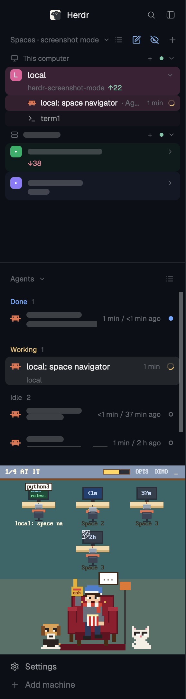

# herdr-screenshot-mode

Hide the names of chosen spaces and machines in the [Herdr app](https://herdr.dev) so you can take screenshots or share your screen without leaking client names, repos or hostnames.

Hover a space or machine in the Spaces sidebar and click its eye to mark it. Or click the pen next to "Spaces" and add phrases (a client name, a hostname, a repo): anything whose name, title, folder, repo or branch contains one is hidden automatically. Then press Cmd+Shift+H, or click the eye next to "Spaces", to turn screenshot mode on. Marked spaces show as "Space N" and marked machines as "Machine N" everywhere: the sidebar, tab bar, agents list, pane headers and status bar. Press Cmd+Shift+H again to get the real names back. Hover the eye next to "Spaces" for a reminder.

It can't hide what your terminals print (shell prompts, paths in output). See [screenshot-mode/RECIPE.md](screenshot-mode/RECIPE.md) for the details and how it is built.

## Installation

Ask your agent to add this mod (it reads every file first), or by hand:

1. Copy the five folders in `screenshot-mode/mods/` into `~/.config/herdr-app/mods/`.
2. Merge `screenshot-mode/keys.json` into `~/.config/herdr-app/keys.json` (it binds `cmd-shift-h`).
3. In your own layout (clone a shipped one first with `herdr-app do layout.clone`), swap the mod names:
   `spaces` → `screenshot-spaces`, `agents` → `screenshot-agents`, `tabs` → `screenshot-tabs`,
   `workspace-status` → `screenshot-status`, and the pane header's `pane` → `screenshot-pane`.
   Skip any block your layout doesn't have.

The mods are clones of Herdr 0.1.10's shipped `spaces`, `agents`, `tabs`, `workspace-status` and `pane`, with masking added. They run only what those already run (`git` for the Spaces list, `hc machine ls`), make no network requests and read no files outside their folders. Delete the folders and switch your layout back to remove it.
