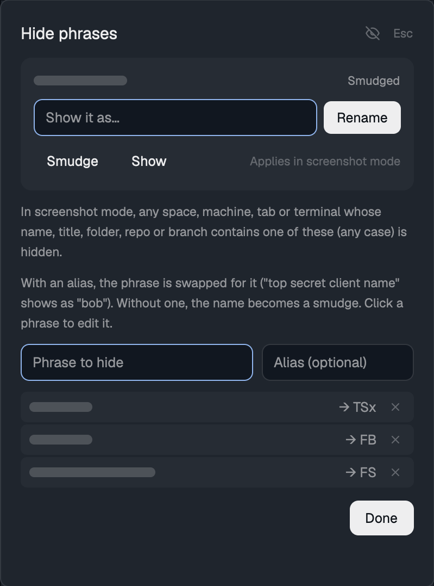

# Screenshot mode

A switch in the Spaces sidebar that hides the names of chosen spaces and machines so the window can be screenshotted or screen-shared safely. Hover a space or a machine header and click its eye to mark it. Or add phrases to a hide list (the pen beside "Spaces"), and anything whose name, title, folder, repo or branch contains one is hidden automatically. A phrase can have an alias: with "top secret client name" → "bob", a space called "top secret client name api" shows as "bob api". Then turn screenshot mode on with the eye beside "Spaces" or Cmd+Shift+H. Hidden spaces without an alias read "Space 2", hidden machines read "Machine 1", and their tabs, agents, pane titles, folders, repos and branches are masked across the window. Unmarked spaces stay as they are.

## What you see

- **Spaces header** (31px tall, 11.5px dim text, 16px left padding). It reads "Spaces", or "Spaces · screenshot mode" while the mode is on. To the left of the existing + button sit two 26×26 buttons (14px icons, 6px radius): a pen (`mods/workspace-chrome/square-pen.svg`, `accent` when the phrase list has entries, else `dim`) that opens the phrase dialog, then an eye. It shows an open eye in `theme().dim` while off, and a crossed-out eye in `theme().accent` while on.
- **Help box.** While the pointer is over the header eye, a box appears 31px from the top, 8px in from both sides. It has `popover` background, `border` 1px border, 8px radius, 10px padding and 12px `muted` text. A `foreground` semibold title sits above the instruction lines. Off: "Screenshot mode", "1. Hover a space or machine and click its eye to mark it hidden.", "2. Click this eye or press Cmd+Shift+H to mask marked names.", "3. Click the pen to edit phrases that hide matching names automatically." On: "Screenshot mode is ON", "Marked spaces and machines show as "Space N" / "Machine N".", "Click the eye or press Cmd+Shift+H to turn it off.", "Click the pen to edit the hide phrases." It draws over the list.
- **Phrase dialog.** A Herdr dialog (380 wide, sized to content) with `popover` background and 18px padding. It has a 15px semibold "Hide phrases" title with a dim "Esc" at the right, then an 11.5px `muted` explanation: "In screenshot mode, any space, machine, tab or terminal whose name, title, folder, repo or branch contains one of these (any case) is hidden." A second `muted` line: "With an alias, the phrase is swapped for it ("top secret client name" shows as "bob"). Without one, the name becomes "Space 2" or similar. Click a phrase to edit it." Below that are two 34px inputs side by side (8px radius, `background` fill, 8px gap): "Phrase to hide" filling the width with an `accent` border, then "Alias (optional)", 140px wide with an `input` border. Then comes the list, 30px per row (at least one row, at most 220px) and scrolling: one 28px `raised` row per phrase, showing the phrase, then "→ bob" in `muted` (or "no alias" in `dim`), then a 12px × button. With no phrases it shows a dim "No phrases yet.".

   A `solid` "Done" button sits at the bottom right.
- **Row eyes.** Each space row and each remote machine header shows a 12px eye at its right end on hover. The eye is open when the item is not hidden, and crossed out (`accent`) when it is hidden, whether marked by hand or matched by a phrase. While the mode is off, hidden items keep showing their crossed-out eye without hover so you can see what will be hidden. While the mode is on, the eyes only appear on hover, so a screenshot shows nothing.
- **Aliases.** When the text shown contains only phrases that have aliases, each phrase is replaced by its alias (case-insensitive, every occurrence, longest phrase first) and the rest of the text stays. This covers space and machine names, tab names, pane titles and folders, agent rows, and repo and branch text. If the text contains a phrase without an alias, contains no phrase at all (it was hidden through its folder or its machine), or belongs to an item marked by hand with an eye, the stand-in below is used instead.
- **Masked space row.** Without an alias, the name becomes "Space N" (N is the space's 1-based position in `spaces()`). The avatar keeps its color but shows "•" instead of the first letter. The repo, branch and ahead/behind tail is dropped.
- **Masked machine.** The header, the "New space on" rows of the new menu and the agents list show "Machine N". N is the 1-based position of that name among marked machines, sorted by name. "This computer" is never masked.
- **Tab bar.** A masked tab (its space is masked, or its name or any of its terminals' title, folder or branch matches a phrase) shows its program's name ("Claude Code", "zsh"), or "Tab N" when there is no program.
- **Agents list.** Agents in a masked space show the masked space name, and the program name instead of the tab name or title. The list is always by priority (Needs you, Done, Working, Idle, with Pinned on top). The shipped mod's "Grouped by space" view and its sort button are removed. Rows show the tab (or the agent's title) on the first line and, on a second 11px line, the space and the machine. The machine tag on remote agents is masked.
- **Space tree.** A chevron at the right end of each space row lists its tabs under it. When another space is selected it opens, every other space closes (hand-opened ones too) and its machine unfolds, so the selected tab's row is on screen: the list can't be scrolled from code, since only virtual lists can and their rows take no clicks. Selecting any tab also reopens its space if it was closed by hand. Other spaces can still be opened by hand until the next change of space. A tab with one pane is one row: the pane's program icon, the tab name, and after a dimmed "·" the agent's own title or the shell's last command (left out when it repeats the tab or program name). A tab split into several panes is a tab row with a row per pane under it. Agents' live sub-agents nest under them. Clicking a tab selects it, a pane row focuses that pane, and a sub-agent opens in peek. Names go through the same tab masking as the tab bar. The last command comes from the `cmd` label that `screenshot-mode/last-command.zsh` sets (a zsh `preexec` hook running `hc label $HC_TERMINAL_ID cmd=...`; a command typed with a leading space clears it). Screenshot mode never shows commands, since they can hold tokens that no phrase would catch.
- **Timing.** Agent rows in both panels, and shell rows in the space tree, show "12 min" while running and "12 min / 3 min ago" after (how long the last turn or command ran, and when it ended). Agent turns are timed from what each mod sees: a turn starts when the agent turns working and ends when it stops, kept in the mod's localStorage (`timing.js`, the same file in both mods). An agent not yet seen working falls back to the agents panel's old "10m" age, or nothing in the tree. The core's `status_ms` would be better but `terminals()` doesn't keep it current. For shells, `last-command.zsh` also sets `cmd_start` and `cmd_end` labels (ms).
- **Folding and dense rows.** Clicking the "Spaces" or "Agents" title folds that section to its header (31px and 42px): the mod finds its own layout block by `content.mod` and runs `layout.resize {id, weight: 0}`, so the block's `min` holds it at header height, then puts back the size it had on unfold. A fixed `px` size didn't stay put when other blocks resized, so each render folds the block again (at most once a second) if its weight isn't 0. Folded, the title shows a count (and for Agents the most urgent state). A list icon in each header switches to dense rows: one-line agent rows with the space and machine dimmed after the name, and 24px space rows without the tab tree. Both states live in each mod's localStorage (`section.js`, the same file in both mods). Layout blocks clamp to their `min`, so a layout needs `min` of 31 and 42 on those blocks for folding to reach the header.
- **Pane header.** In a masked space the terminal title falls back to the program name and the folder text is blank.
- **Status bar.** A masked machine shows as "Machine N". The branch is hidden when the active space is masked or the branch matches a phrase.
- **Repo and branch tail.** In the Spaces list it is also dropped when the repo or branch matches a phrase.

## How it behaves

- Agent statuses (working, blocked, done, idle) look exactly as in Herdr's shipped mods. Only text changes.
- Clicking a row's eye toggles that space or machine in the marked list. If the item is hidden only by a phrase, the click opens the phrase dialog instead, since a phrase match can't be unmarked from the row. An eye click never selects the space or folds the machine.
- Marking a machine, or a phrase matching its name, masks every space on it.
- A space is hidden when it is marked, its machine is hidden, or its name or folder matches a phrase. A tab is hidden when its space is, or its name or any terminal in it (title, folder, branch) matches. Only that tab is masked then, not its space.
- In the phrase dialog, Enter in either input adds the trimmed phrase with its alias. Blanks are dropped, and re-adding a phrase (any case) replaces its alias. Clicking a row loads the phrase and alias back into the inputs for editing. × removes one, and Esc or Done closes it. Changes apply at once everywhere.
- Clicking the header eye, or the key `cmd-shift-h` (action `screenshot-spaces.privacy`), toggles the mode. Every mod re-renders at once because the state is shared.
- The marked list and the on/off flag persist across restarts (shared state).
- Hovering the header eye shows the help box. Moving off hides it.

## Built from

Five clones of Herdr 0.1.10's shipped mods, each with the same `privacy.js` helper copied into its folder:

| Mod | Cloned from | Replaces in the layout |
| --- | --- | --- |
| `screenshot-spaces` | `spaces` | the Spaces sidebar block |
| `screenshot-agents` | `agents` | the Agents sidebar block |
| `screenshot-tabs` | `tabs` | the tab bar block |
| `screenshot-status` | `workspace-status` | the status bar block |
| `screenshot-pane` | `pane` | the pane `header.content.mod` |

- **State.** It lives in `shared("privacy")` as `{ on: boolean, hidden: string[], phrases: { text, alias }[] }` (a plain string in `phrases` reads as a phrase with no alias), with keys `space:<space id>` and `machine:<name>`. Remote space ids keep their `machine/` prefix. `setShared("privacy", …)` writes it.
- **`privacy.js` exports.** `privacyOn`, `isMarked(key)`, `toggleMarked(key)`, `togglePrivacy()`, `spaceKey(id)`, `machineKey(name)`, `spaceMasked(spaceOrId)`, `machineMasked(name)`, `spaceName(space)`, `machineName(name)`, `spaceOfTab(tabId)`, `tabMasked(tabId)`, `phrases()` (always `{ text, alias }`), `setPhrases(list)`, `matches(...texts)` (case-insensitive substring), `aliased(text)` (the text with aliases swapped in, or null), `tabText(tabId, text, fallback)` and `spaceText(space, text, fallback)` (the text as shown: real, aliased or the fallback), and `machineHidden`, `spaceHidden` and `tabHidden` (the same tests ignoring whether the mode is on, for the sidebar's eyes). It reads `spaces()`, `panes()`, `shared` and `setShared` from `herdr`. Masked machines are numbered among every hidden machine name (marked, or phrase-matched on a space's machine), sorted.
- **screenshot-spaces.** It adds `nextCommand` in `init` (a loop that toggles on `"privacy"`), a `hoverRow` id set by `on_hover` on rows and machine headers, an `eye(id, key, hidden, t)` helper and `this.tip` for the help box. The same mod is the phrase dialog: `openOverlay({ mod: "screenshot-spaces", kind: "dialog", width: 380, height: 420, props: { phrases: true } })`. With `props().phrases`, `init` sets up two `InputState`s (submit in either adds the phrase) and skips the sidebar's git and machine timers, and `render` returns the dialog. The help box is the root `v_flex().relative()`'s last child, positioned `absolute()`. Icons are `mods/screenshot-spaces/eye.svg` and `eye-off.svg` (24×24, stroke `currentColor`, width 2, drawn with `svg()`). It is also the new menu: `props: { newMenu: true, space, own, linked, remotes }`. The header's + opens it for the active space (`own: false`) and right-clicking a space opens it for that space (`own: true`). It lists Terminal and the installed agents (keys 1 to 9) for that space, New space plus "New space on" each connected machine (masked), and New/Open worktree. With `own` it also shows the space's masked name and Rename at the top, and Remove worktree (for a linked worktree) and Close space at the bottom. The agent list shows at most 8 rows and scrolls, so the space's items stay inside the 560px popup. It replaces the shipped `menu` mod's space menu and the old "New space on" chooser.
- **screenshot-agents.** A `sn(a)` helper gives the space name through `spaceName`. Every `a.space_name` uses it. `label(a)` returns `a.program?.name` for a masked tab. The machine tag goes through `machineName`.
- **screenshot-tabs.** The pill name is `tabMasked(c.id) ? program?.name ?? \`Tab ${i + 1}\` : <shipped rule>`.
- **screenshot-pane.** `masked = tabMasked(p.tab)`. The title skips `p.title` when masked and the folder renders "".
- **screenshot-status.** `machineName(space.machine)`, and the branch label only when `!spaceMasked(space) && !(privacyOn() && matches(space.branch))`.
- **Programs and files.** The mods run only what the shipped mods already run: `git` (branch and status for the Spaces list, via `exec`) and `hc machine ls --json`. They make no network requests and read no files outside their folders.

## Watch out

- A mod cannot import another mod's files (`../other-mod/x.js` fails `herdr-app check` with "resolves outside the application directory"). So `privacy.js` is copied into every folder. Keep the copies identical.
- `View.tooltip(text)` on the header eye never appeared in the sidebar block on 0.1.10. That is why the help box is drawn by the mod on hover.
- An absolute overlay must be the root's last child, or the list paints over it.
- `mod.clone` rewrites `mods/<name>/…` asset paths. When renaming a clone, rewrite them too: `mods/screenshot-tabs/win-*.svg`, `mods/screenshot-pane/*.svg`, `mods/screenshot-spaces/eye*.svg`, and the spaces mod's own overlays (`openOverlay({ mod: "screenshot-spaces" })` for the phrase dialog and the new menu).
- A dialog sizes to its content, so a `flex_1().min_h(0)` list inside it collapses to nothing. A scrolling list with only `max_h(220)` grows to the full 220px and pushes Done out of the dialog. Give it an explicit height: `h(Math.min(Math.max(count, 1) * 30, 220))`.
- Saving a mod reloads it in place without re-running `init`. A flag set there won't show until the next start.
- It cannot mask what a terminal prints (shell prompts with user and host, paths in output), the Cmd+P picker, the Files and Changes panels, menus or other mods. Sub-agent rows in the agents list and the space tree keep their own names.
- The key is `cmd-` (macOS). On Linux or Windows bind `ctrl-shift-h` or similar instead. The help text says Cmd+Shift+H either way.
- These are clones of Herdr 0.1.10's mods. On a later Herdr, a fresh build from this recipe on top of new clones is safer than copying the files.
- To use it, point your own (cloned) layout's blocks at the five mods. The installer has to do this, since the mod ships no layout.

## Done when

1. `herdr-app check ~/.config/herdr-app/mods/<each of the five>` passes.
2. The layout's spaces, agents, tab bar, status bar and pane header blocks name the `screenshot-*` mods, and `herdr-app status` shows `"errors": []`.
3. Hovering the eye beside "Spaces" shows the help box. Moving away hides it.
4. Clicking a space's eye with the mode off leaves a crossed-out eye on that row, and `shared("privacy").hidden` contains `space:<id>`.
5. Cmd+Shift+H changes the header to "Spaces · screenshot mode". The marked space reads "Space N" with a "•" avatar and no git tail. Its tabs show program names, its agents show "Space N", its pane header has no folder, and the status bar has no branch.
6. Marking a remote machine and turning the mode on shows "Machine 1" in the sidebar header, the new menu, the agents list and the status bar, and masks every space on it.
7. Clicking the pen opens "Hide phrases". Adding a phrase found in a space's name (mode on) turns that row into "Space N" without any eye click, and with the mode off its row shows a crossed-out eye. Clicking that eye opens the dialog. Removing the phrase brings the name back.
8. Adding "top secret client name" with alias "bob": a space named "top secret client name api" reads "bob api", and a terminal titled "notes on top secret client name" shows "notes on bob" in its pane header. A space also marked by hand still reads "Space N".
9. A phrase found only in one tab's terminal title or folder masks that tab's pill, pane header and agent rows, but not the space name.
10. Cmd+Shift+H again restores every real name. Marks survive a restart.
